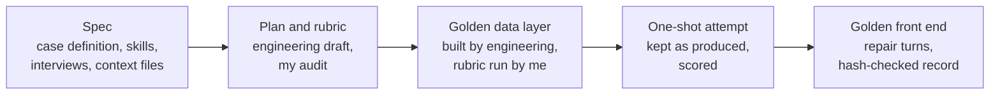

# Season scoreboard: one evaluation case, end to end

Contract work through Turing, 2026.

The client and the project stay unnamed, and everything I produced for it belongs to them. This repo is a write-up of what I did. It has no spec text, skills, interviews, rubrics, prompts, code, screenshots or data from the project.

## The case

The client is building an AI app builder: you describe the app you want, give it your data, and a model builds a working app on top of it. To measure how well it does that, they need evaluation cases. Each case pairs a realistic request and the material that comes with it, a reference build that shows what a good answer looks like (the golden), and a rubric for scoring attempts against it.

I owned one case from start to finish: a basketball season scoreboard for a coach and the parents who follow the team. It came in two versions for two different users, and each version got its own golden build.

## What I wrote

- The case definition.
- Two skills the model works from, one for building the data layer and one for the interface.
- A user interview for each version, plus the context files the second user brings with them.
- The prompts for both golden front ends.

## What I checked

- Engineering drafted the build plan and rubric for each version. I audited both against the spec and fixed what didn't match before they went to QC.
- Engineering built the golden data layer from the approved plan. I ran each rubric against it, with automated checks on an export plus checks in the live file.
- For each version I generated the model's one-shot attempt from a fresh copy of the golden, kept it exactly as produced, and scored it.
- The golden front ends came from steering the model through repair turns. Every turn's prompt, the model's response and the code it produced went into an edit history, with my QA notes on each turn.

## A silent bug in the record

The front-end code from each turn went into documents as part of that record. One version's code blocks lost some of their template placeholders (the `${...}` spans) without any sign on the page: the doc editor had turned them into equation objects on paste, and find and replace can't see those. I rebuilt the affected blocks and confirmed each one against the editor's copy by SHA-256.

## Related

- [ianalloway.xyz/#evals](https://ianalloway.xyz/#evals): this case and my other 2026 evaluation contracts.
- [spendaudit](https://github.com/ianalloway/spendaudit): a benchmark I published with every model response and a one-command recount.
- [juryrig](https://github.com/ianalloway/juryrig): a toolkit for auditing LLM judges before you trust their scores.
